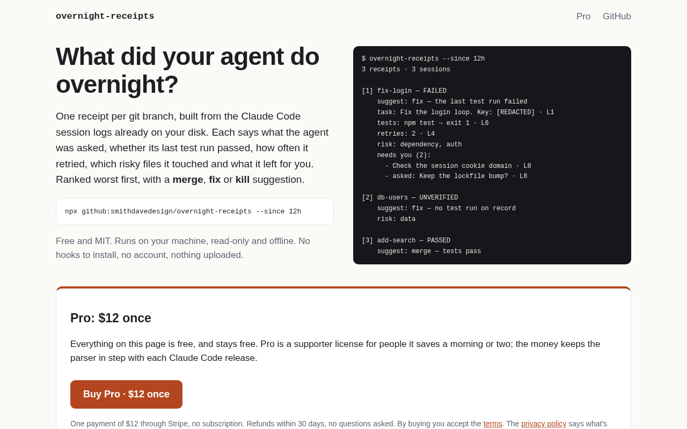
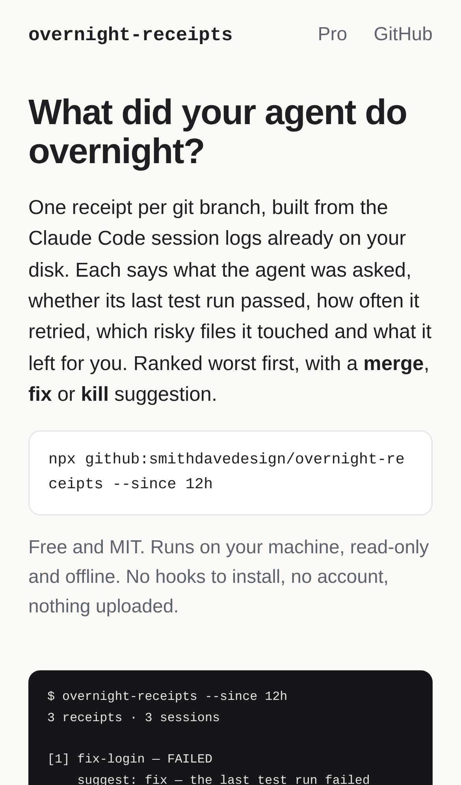
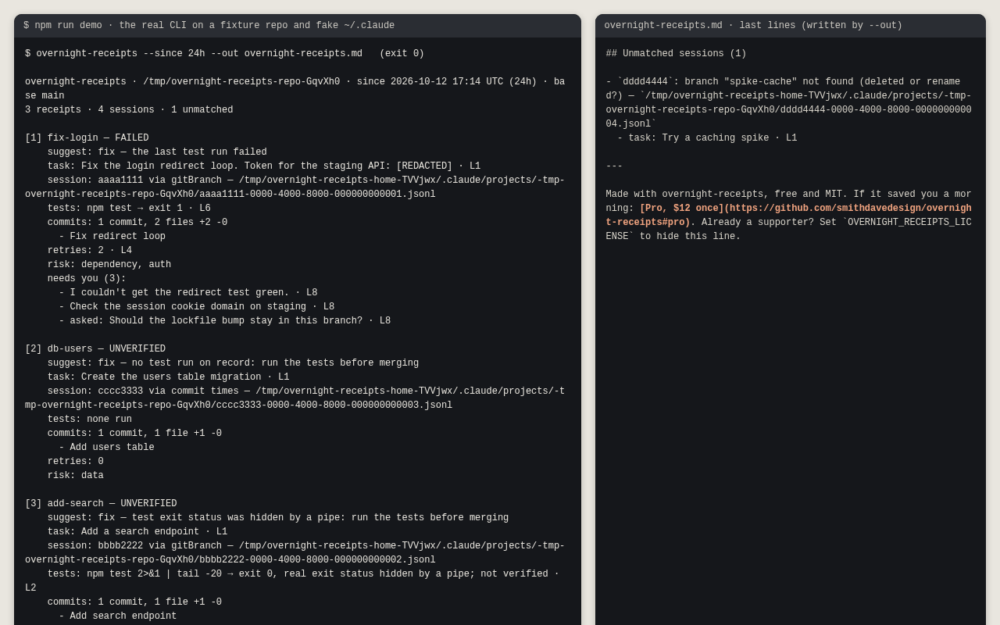
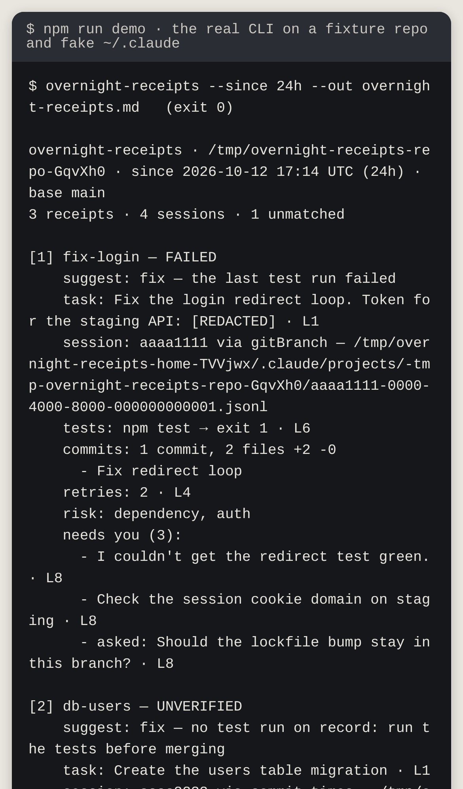
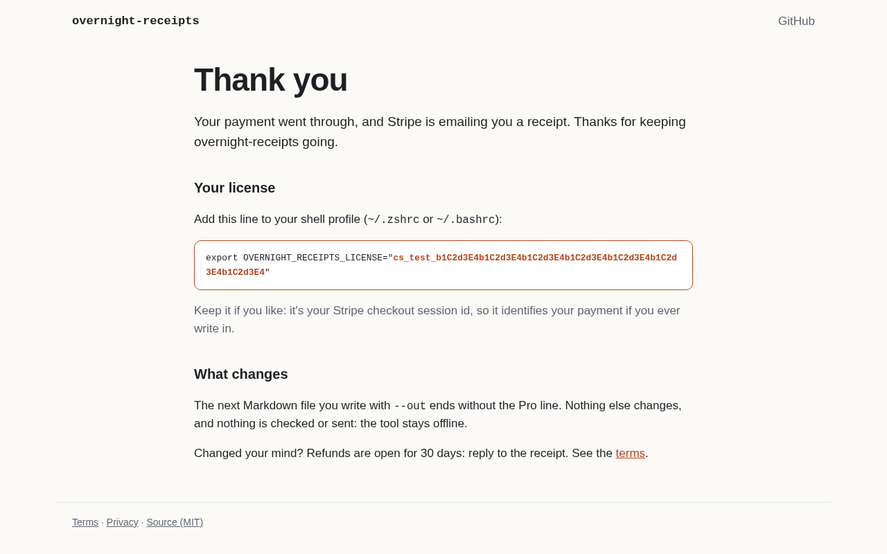
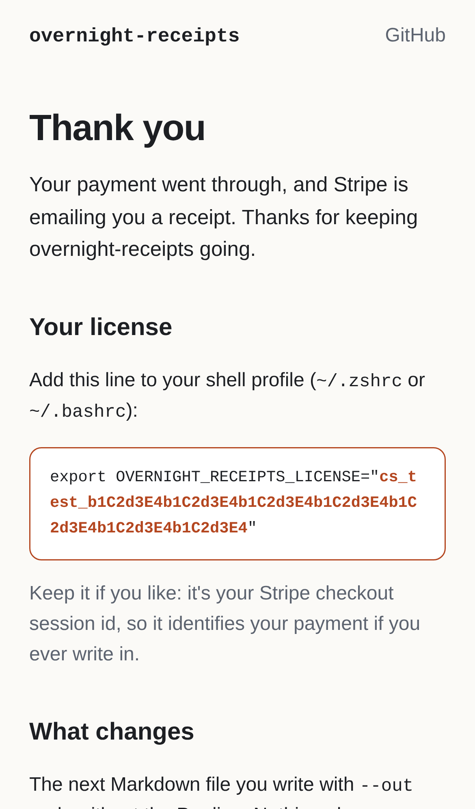

# overnight-receipts — morning triage receipts for overnight AI agent runs

## Screenshots


The storefront (`site/`, served locally by `site/serve.js` with `vercel.json`'s CSP) shows the install line and a sample receipt. With `PRO_CHECKOUT_URL` set (a stand-in test link here), the $12 Buy button and the terms and privacy links are above the fold.


The same page on a phone: one column, and the install line wraps instead of running off the screen.


`npm run demo` runs the real CLI on a fixture repo. Receipts are ranked FAILED first, the planted token shows as `[REDACTED]`, and the Markdown file ends with the Pro link.


The same real run, readable at phone width.


After payment, Stripe redirects to `thanks.html?session_id=…`. The page turns the (stand-in) session id into the `export OVERNIGHT_RECEIPTS_LICENSE="…"` line, which hides the footer.


On a phone the license string wraps, so all of it is visible to copy.

_Made with `npm run screenshots` (Playwright and the system Chromium, sample data only)._

_Formerly **dawnlog**: renamed 2026-10-11 because the npm name `dawnlog` belongs to an unrelated tool. The old GitHub URL redirects here._

For developers who let Claude Code run unattended, it reads the session logs already on disk plus git branches and prints a per-branch receipt of what the agent decided, retried, skipped and verified, ranked for merge/fix/kill.

- [Research](RESEARCH.md): findings and sources
- [PRD](PRD.md): what it's for, with a status table of what's built
- [Roadmap](ROADMAP.md): M1–M3, all done, including the storefront
- [Build notes](BUILD.md): decisions, architecture, test plan, what's left

Effort: Low · Confidence: Medium · License: [MIT](LICENSE)

_Researched by the idea pipeline on 2026-10-10 ([original record](https://github.com/smithdavedesign/idea-factory/tree/main/ideas/dawnlog)); repo created on David's go-ahead 2026-10-11._

## Quick start

Requires Node ≥ 22 and git. There are no dependencies and nothing to build.

```sh
npx github:smithdavedesign/overnight-receipts --since 12h     # in a repo you ran Claude Code in
node bin/overnight-receipts.js --since 12h                    # from a checkout
npm link && overnight-receipts --since 12h                    # put `overnight-receipts` on PATH
npm run demo                                       # a fixture run in a temp dir: receipts, Markdown and a digest
```

## What a receipt says

```
[1] fix-login — FAILED
    suggest: fix — the last test run failed
    task: Fix the login redirect loop. Token for the staging API: [REDACTED] · L1
    session: aaaa1111 via gitBranch — ~/.claude/projects/-Users-you-app/aaaa1111-….jsonl
    tests: npm test → exit 1 · L6
    commits: 1 commit, 2 files +2 -0
      - Fix redirect loop
    retries: 2 · L4
    risk: dependency, auth
    needs you (2):
      - Check the session cookie domain on staging · L8
      - asked: Should the lockfile bump stay in this branch? · L8
```

| Field | Meaning |
|---|---|
| status | `FAILED`, `UNVERIFIED` or `PASSED`, from the last test/lint command. A test piped into `tail` that exits 0 is never PASSED: it's FAILED if the output shows failures, otherwise UNVERIFIED. A run the user denied never ran, so it doesn't count. |
| suggest | `merge`, `fix` or `kill`, with the reason. See [Triage](#triage). |
| summary | Only with `--summarize`: two sentences from your own `claude -p`. |
| task | The first real user prompt. |
| session | The session id, how it was matched (`entire`, `gitBranch`, `worktree` or `commit times`), and the transcript path. |
| tests | The last test command and its result. |
| commits | Commits on the branch since it left base, the diff stat, and up to 5 subjects. |
| retries | Re-runs of a command that had just failed. |
| risk | `dependency` (lockfiles and manifests), `data` (`migrations/`, `*.sql`, Prisma schema), `auth`, `payments`. |
| scope | Changed files outside the task's area: the directories the prompt names, or else the ones with most of the changed lines. |
| needs you | What the agent's final message left undone (phrases like "I couldn't…", "you'll need to…", bullets under "Next steps"), and questions it ended on. |

`· L6` is the transcript line the field came from (`· aaaa1111 L6` when a branch has several sessions). `--json` carries the full `file:line` for every field.

## Commands

```
overnight-receipts [--since 12h] [--repo PATH] [--base BRANCH] [--out FILE.md] [--json] [--summarize]
overnight-receipts digest --out FILE [--since 12h] [--repo PATH]... [--format text|md] [--summarize] [--quiet]
```

| Option | Does |
|---|---|
| `--since` | Window: `30m`, `12h`, `2d`, `1w` or a date like `2026-10-10`. Default `12h`. |
| `--repo` | The repo to triage. Default: the current directory. `digest` takes it several times. |
| `--base` | The branch the others are compared with. Default: origin's HEAD, then `main`, `master`, `trunk`, `develop`. |
| `--out` | Also write the receipts as Markdown (for `digest`: the digest file). |
| `--json` | Print the receipts as JSON instead of text. Schema: [`schema/receipts.schema.json`](schema/receipts.schema.json). |
| `--summarize` | Add a two-sentence summary per receipt (first 20) from `claude -p`. The only option that runs anything other than git. |
| `--format` | `digest` only: `text` (default, good for WhatsApp/Slack) or `md`. |
| `--quiet` | `digest` only: print nothing on success. |

Exit codes: 0 done (also when there's nothing to triage or no `~/.claude/projects`), 1 an error (not a repo, unknown base, a digest repo failed), 2 a usage error.

### Triage

**Suggestions.** The first rule that applies wins:

| Suggestion | When |
|---|---|
| kill | No commits ahead of base: nothing to merge. |
| kill | Already in base by a squash or rebase merge, but a session ran on it. |
| kill | FAILED after 5 or more retries: the agent thrashed, and a fresh start is cheaper. |
| fix | No merge base with the base branch. |
| fix | FAILED. |
| fix | UNVERIFIED: there's no passing test run, so it can't be merged blind. |
| fix | PASSED, but the agent left items for you. |
| merge | PASSED. Says "review … first" when risky paths or out-of-area files changed. |

overnight-receipts never suggests `merge` without a passing test run.

**Ranking**, worst first:
1. Status: FAILED, then UNVERIFIED, then PASSED.
2. Risky before not risky.
3. More risk labels.
4. More retries.
5. More needs-you items.
6. Branch name.

**Which branches get a receipt.** A branch gets one if it changed in the window and still has work that isn't in base, or if a session in the window ran on it. Branches already merged are counted in a note and not listed. That covers fast-forward merges, and squash merges, which are detected by content or patch-id. Sessions that can't be placed are listed under "Unmatched" with the reason; they're never dropped.

### Morning digest (cron)

`overnight-receipts digest` writes one short file across repos, one line per branch, worst first. It replaces the file atomically, so a reader never sees half a digest:

```
overnight-receipts digest · since 2026-10-11 07:00 UTC (12h)

app: 2 branches: 1 fix, 1 merge
  fix   fix-login (FAILED) — the last test run failed · retries 2 · risk dependency+auth · 2 for you
  merge add-search (PASSED) — tests pass
site: nothing to triage
```

Example crontab entry. Note that `%` must be escaped in crontab. Sending is up to you; here it goes to WhatsApp through OpenClaw:

```cron
30 7 * * * cd ~ && overnight-receipts digest --since 12h --repo ~/code/app --repo ~/code/site --out ~/.overnight-receipts/digest.txt --quiet && openclaw message send --channel whatsapp --target "+1…" --message "$(cat ~/.overnight-receipts/digest.txt)"
```

`scripts/morning-digest.sh` wraps this for launchd or cron. It skips anything in the list that isn't a git repo. It sends the digest to WhatsApp through `openclaw message send` only when a branch needs triage, so quiet mornings send nothing. A failed send is retried (3 tries, 5 minutes apart, by default), so a gateway that's reconnecting still delivers. It is configured with environment variables, listed at the top of the script. On macOS, launchd jobs can't read `~/Documents`, so point it at checkouts outside it.

### Summaries (`--summarize`)

For each receipt, overnight-receipts runs `claude -p --output-format text --no-session-persistence --tools ""` in a temp directory. It sends the receipt's facts and the agent's final message on stdin, both secret-redacted first.

- It has no tools and writes no session file, so overnight-receipts never reads its own summaries back as sessions.
- It uses whatever auth `claude` has. A Claude subscription login costs nothing extra; an `ANTHROPIC_API_KEY` in the environment is billed per call.
- Set `OVERNIGHT_RECEIPTS_CLAUDE` to use another binary.
- If a summary fails, a note says why and the receipts print as usual.

### Entire checkpoints

If the repo has [Entire](https://entire.io)'s metadata branch (`entire/checkpoints/v1`, local or `origin/`), overnight-receipts reads it as well:

- **Matching:** an `Entire-Checkpoint:` trailer on a branch's commit places that checkpoint's sessions on the branch (`via entire`). This is the strongest evidence, so it's checked first.
- **Sessions from other machines:** sessions Entire stored from elsewhere (another laptop, a CI runner) are parsed from the checkpoint's `full.jsonl`. They are cited as `entire:<checkpoint>/<n>/full.jsonl:<line>`.
- **No local logs needed:** a repo with Entire works even without `~/.claude/projects`.
- **Not receipts:** Entire's own branches never get a receipt.
- **Not supported yet:** Entire's newer ref-based storage (`refs/entire/checkpoints/…`). overnight-receipts says so in a note.

## Safety

- **Read-only and offline.** Without `--summarize`, the only subprocess is `git` and nothing touches the network. A test asserts this by trapping every subprocess and socket.
- **Redacted output.** Every byte printed or written is secret-redacted (12 formats) and stripped of terminal escape codes. That covers stdout, stderr, the Markdown file, JSON and the digest. Redaction is best-effort: a token format not on the list will leak.
- **Escaped Markdown.** Transcript text in Markdown can't inject HTML, images or links.
- **Shell-safe git calls.** Branch names and transcript strings never reach a shell. git is called with argument arrays and full `refs/heads/` names.

## Pro

overnight-receipts is free and MIT, and it stays that way: everything in this README works without paying. **Pro is $12 once**, for people it saves a morning or two. The money pays for keeping the parser in step with each Claude Code release.

What paying changes:
- **The footer goes away.** The Markdown file written by `--out` ends with a one-line link to this section. Set `OVERNIGHT_RECEIPTS_LICENSE` to the license string you get after paying, and the line is gone.
- **The terminal, `--json` and the digest are never affected.** They don't show the line, licensed or not.

It's an honour system. Any non-blank value hides the line, and nothing is checked, sent or logged; the tool stays offline.

**Where to buy.** The storefront in [`site/`](site/) is built: a landing page with the Buy button (a Stripe Payment Link), the terms, the privacy policy, and a thank-you page that gives you your license string after payment. It deploys to a free static host. Checkout opens once the storefront is live and the Payment Link is switched on, and this section will link to it then. Until then there's nothing to buy. Refunds will be open for 30 days, no questions asked.

## Development

```sh
npm test        # 265 tests (node:test, no installs), ~4 s
UPDATE_GOLDEN=1 node --test test/m2.test.js   # after an intended ranking change; review the diff of test/golden/ranking.txt
npm run site:preview                          # build the storefront to dist/ and serve it on http://127.0.0.1:4173/
npm install && CHROMIUM_PATH=/path/to/chromium npm run screenshots   # regenerate docs/screenshots/ (never downloads a browser)
```

| Path | What |
|---|---|
| `bin/overnight-receipts.js` | 5-line shim (npm links bins through a symlink) |
| `src/cli.js` | flags, `--since`, exit codes, `--out`, `--json`, `--summarize`, `digest` |
| `src/sessions.js` | Claude Code JSONL parser: task, Bash runs and results, retries, final message, line numbers |
| `src/git.js` | read-only git queries: branches, base, worktrees, commits + trailers, numstat, squash detection, blobs |
| `src/report.js` | the report: repo filter, session→branch matching, receipts and their `sources` |
| `src/triage.js` | merge/fix/kill rules, ranking, task area and out-of-area files |
| `src/deferred.js` | "needs you" items from the final message |
| `src/entire.js` | Entire checkpoint reading and trailer links |
| `src/summarize.js` | `--summarize` via `claude -p` |
| `src/digest.js` | `overnight-receipts digest` rendering and atomic write |
| `src/render.js` | terminal, Markdown and JSON output |
| `src/pro.js` | the Pro footer in the Markdown file, and the license variable that hides it |
| `src/redact.js` | secret redaction and escape stripping |
| `schema/receipts.schema.json` | the `--json` schema |
| `site/pages/` | the storefront: landing, terms, privacy, thanks, stylesheet, `license.js` (session id → license line) |
| `site/build.js` | `npm run site:build`: fills in the price and license variable from `src/pro.js` and the Buy button from `PRO_CHECKOUT_URL`, then writes `dist/` and `dist/_headers` (the same headers, for Cloudflare Pages) |
| `site/serve.js` | local preview of `dist/` with `vercel.json`'s headers (127.0.0.1 only) |
| `vercel.json` | Vercel build settings and security headers (CSP, no-referrer) |
| `scripts/screenshots.mjs` | `npm run screenshots`: builds and serves the site, runs the demo, captures `docs/screenshots/` |
| `test/` | fixture-driven tests: `cli` (M1), `m2`, `m3` and `storefront` exit criteria; unit tests per module; `perf` |
